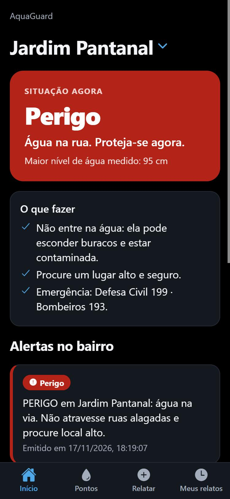
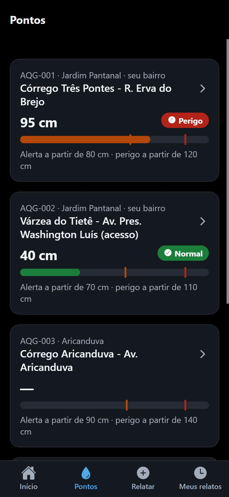
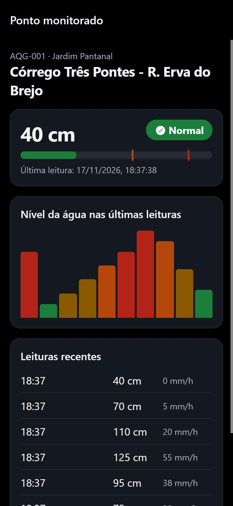
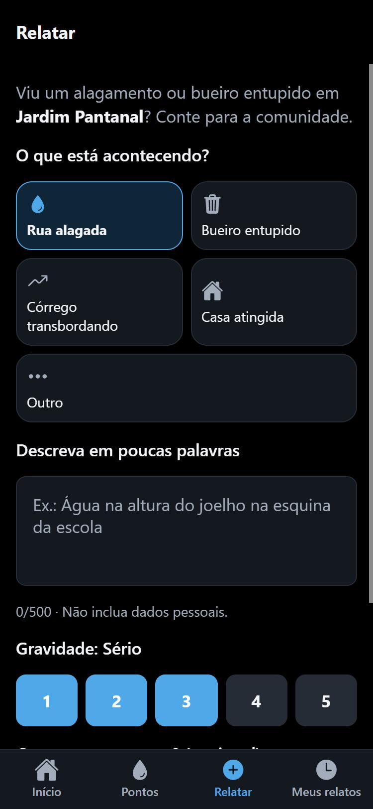
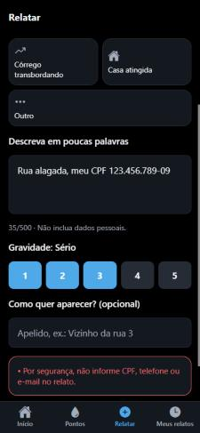

# AquaGuard · App Mobile (React Native + TypeScript + Expo Router)

**Integrantes:** Guilherme Cezarino Simoes · Fabrini Soares

## Ficha da CitizenTech
| | |
|---|---|
| **Nome** | AquaGuard |
| **Cidade e bairro** | São Paulo — Jardim Pantanal (Zona Leste) e outros pontos de alagamento (Aricanduva, Ipiranga, Pacaembu) |
| **Cidadão beneficiado** | Morador de área sujeita a alagamento (famílias, idosos, pessoas com mobilidade reduzida) e quem passa por essas ruas |
| **Problema, em uma frase** | Quem mora perto de córregos de São Paulo só percebe a enchente quando a água já está na porta, sem tempo de proteger a família e os bens. |
| **Como funciona** | Sensores ESP32 medem o nível dos córregos e a chuva → API calcula o risco e emite alerta do bairro → o app mostra a situação e o que fazer; moradores relatam alagamentos; um modelo de ML com dados do INMET avisa na véspera a chance de chuva forte. |
| **O que cada parte faz** | IoT: mede e alerta no local · API C#: regras, banco e alertas · App: consulta, alerta e relato · ML: previsão de chuva forte · Cyber: protege dados dos relatos · Linux: hospeda e monitora |
| **Link do repositório** | [https://github.com/GuilhermeCezarinoSimoes/aquaguard-gs2026](https://github.com/GuilhermeCezarinoSimoes/aquaguard-gs2026) |
| **Indicador de impacto** | Minutos de antecedência entre o alerta e a água na rua; nº de relatos resolvidos; % de chuvas fortes avisadas na véspera (69 % no teste do ML) |
| **ODS conectados** | 11 (cidades resilientes — meta 11.5, reduzir mortes e perdas por desastres), 13 (adaptação ao clima — meta 13.1), 3 (saúde — evitar leptospirose e afogamentos), 10 (redução das desigualdades — áreas periféricas são as mais afetadas) |

## Jornada principal do cidadão
1. Abre o app e vê **a situação agora** do seu bairro (Normal / Atenção / Alerta / Perigo) e **o que fazer**.
2. Consulta os **pontos monitorados** e o histórico do nível da água.
3. **Relata** um alagamento ou bueiro entupido (funciona sem internet).
4. Acompanha **seus relatos** e o protocolo gerado.

## Telas
| Início | Pontos | Detalhe do ponto |
|---|---|---|
|  |  |  |
| **Relatar** | **Proteção de dados** | **Meus relatos** |
|  |  |  |

_Prints reais do app em execução (Expo Web, viewport de celular 375×812, tema escuro do sistema) consumindo a API C# local._

## Requisitos atendidos
| Critério | Implementação |
|---|---|
| Telas e navegação | Expo Router: abas (`src/app/(tabs)`) + pilha (`sensor/[id]` com parâmetro de rota) + modal (`bairro`) |
| Consumo de dados | `src/lib/api.ts` — API REST do backend C# (timeout, tratamento de erros); fallback para cache e dados de demonstração sinalizados |
| Banco de dados | **SQLite** (`expo-sqlite`) em `src/db/database.ts`: tabelas `relatos`, `preferencias`, `cache`; relatos offline-first com sincronização |
| Acessibilidade | `accessibilityRole/Label/Hint/State`, `accessibilityLiveRegion` em alertas, alvos ≥ 48 px, risco com **cor + ícone + texto**, contraste AA, fonte escalável, tema claro/escuro automático, linguagem simples |
| Aderência ao problema | Situação do bairro, orientações da Defesa Civil, relato colaborativo, funcionamento sem internet |
| Documentação | Este README (ficha, instruções, prints, vídeo) |

## Como rodar
Pré-requisitos: Node 20+ e o app **Expo Go** no celular (ou emulador Android / navegador).
```bash
cd mobile
npm install
# Endereço da API (IP do computador na mesma rede Wi-Fi do celular):
echo EXPO_PUBLIC_API_URL=http://192.168.0.10:5080 > .env
npx expo start            # leia o QR Code com o Expo Go  ·  tecla "w" abre no navegador
npm test                  # testes de validação (Node test runner)
npm run typecheck         # TypeScript estrito
```
Suba antes a API: `cd ../backend && dotnet run --project src/AquaGuard.Api --launch-profile http`
(o perfil escuta em `0.0.0.0:5080`). Sem API, o app funciona com cache/dados de demonstração e avisa o usuário.

> No navegador (Expo Web) o banco local usa `localStorage` (`database.web.ts`), porque o SQLite web exige configurações
> extras; no Android/iOS o app usa **SQLite real**.

## Vídeo (até 3 min)
**Link:** _<inserir link do YouTube>_ · Roteiro: `../docs/roteiros/roteiro_video_mobile.md`
